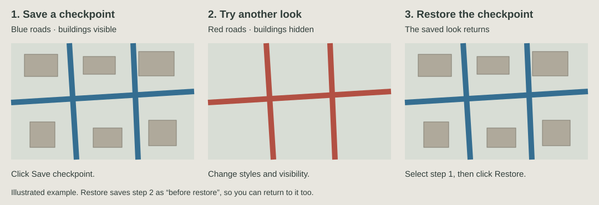

# Checkpoint

*Undo for your map styling.*

A small QGIS plugin for trying different looks without losing the one you liked.
Save a checkpoint, change your map, and come back to it later.

Checkpoint remembers styles, filters, layer order, groups, visibility, and map view.
It doesn't save copies of your data or project files. Keep saving your project as usual.

## What it looks like



You had blue roads and visible buildings. You made the roads red and hid the
buildings, but preferred the earlier version. Select that checkpoint and click
**Restore selected checkpoint**. The blue roads and buildings come back.

Your red-road version is kept as **before restore**. Restore that entry if you
change your mind again.

**Restore applies the whole saved styling state**, not just the change named in
one history row. It doesn't undo edits to geometry or attributes, and it can't
bring back a deleted layer. Clicking a row only opens its preview.

## Install

There isn't a published release download yet. To build the ZIP, clone this repo
and run this command from its folder. Python 3 is enough; QGIS isn't needed to build it.

```sh
git clone https://github.com/Mooly612/checkpoint.git
cd checkpoint
python3 scripts/package.py
```

In QGIS, open **Plugins → Manage and Install Plugins → Install from ZIP**, choose
`dist/checkpoint.zip`, then enable **Checkpoint**. No extra Python packages needed.

The panel opens on the right. Use the toolbar icon or Plugins menu to reopen it.
Restart QGIS after updating the plugin.

Already using a development symlink? Just restart QGIS after updating the source.
Don't install the ZIP over the symlink. [More installation notes](docs/install.md).

## Everyday use

Start by clicking **Save checkpoint** before making changes.

- **Auto** saves after styling changes settle. The default 60 seconds is the
  minimum gap between saves, not a timer that saves the same map repeatedly.
- **Manual** saves only when you click the button. The button also works in Auto.
- **Pin / Unpin** keeps a useful checkpoint from expiring.
- **Rename** gives it a name you can find later, such as “Before changing labels”.
- **Delete** removes it after confirmation.

Unchanged styling isn't saved twice. Panning and zooming alone don't create entries.
Restore deliberately saves both the state before it and the result.
Closing the panel doesn't stop Auto; switch to Manual if you want to pause it.

## Seeing what changed

Small symbol samples show **before → after**, so a change to a few points can
still be seen without fitting the whole project into a thumbnail. Click a row
for the saved map comparison. Restore is a separate button.


These are screenshots from the QGIS tests. They show the preview UI before the
Pin, Rename, Delete, and Settings buttons were added. The map above is deliberately
a small point example; it isn't a full project screenshot.

A map preview focuses on one representative feature in an affected layer. It may
not show every change spread across a large project. Filters, visibility, and
labels often need the map comparison rather than a symbol sample.

If you see **“thumbnails disabled: project is heavy”**, rendering hit its two-second
limit. Toggle **Previews** off and on, then create a new checkpoint. Old empty
previews aren't rebuilt. You can also leave previews off and use the text history.
Slow remote sources may still delay preparation; WMS/XYZ images can be incomplete.

## Settings

Click **Settings…**, then select **Checkpoint** in QGIS Options.

| Setting | Default |
| --- | --- |
| Save previews | On |
| Restore map view | On; turn it off to keep your current zoom and position |
| Unpinned history limit | 20 entries |
| Default automatic interval | 60 seconds |

Lowering the history limit removes older unpinned entries immediately. Pinned
entries stay until you unpin or delete them, including the **before restore** entries.

## Things to know

History stays in your QGIS profile, under `checkpoint/`, not beside or inside the
project file. An unsaved project's history is only in memory until you save it.
Close it before saving and that history is gone.

History is tied to the project path. Moving or renaming a saved project, or using
Save As, doesn't carry its old history to the new path.

Deleted layers are skipped with a message. Later-added layers keep their styling,
although changing a parent group's visibility can still hide them. Memory-layer
features aren't backed up. CRS, layouts, project settings, custom layer order,
and Map Themes aren't restored.

If Checkpoint can't save the before-restore entry, it won't apply the restore.
If a provider fails partway through, some changes may already be applied. The
message explains what happened; the pinned **before restore** entry remains
available. Checkpoint doesn't automatically roll back a failed restore.

Previews are saved images, not live views. Old entries without images stay that
way. Disabling previews stops new image capture but doesn't delete existing ones.
There is no telemetry or cloud sync. Remote QGIS layers can still access their
sources while rendering.

## Does this replace QGIS undo?

For a single layer's styling, QGIS's own undo/redo may be all you need. Map Themes
are useful for named presentation variants. Checkpoint is for keeping a history
of changes across several layers, including their filters and tree positions.

It's still experimental. The Restore wording, popup preview, and growing list of
pinned recovery entries could be clearer. [Alternatives and usability notes](docs/usability.md).

## Tests and compatibility

Tested on **QGIS 3.44.8, Qt 5.15.18, Python 3.12.11, macOS**. The code targets QGIS
3.28+ and 4.x, but those other runtimes haven't been tested yet. Large projects and
remote providers need more testing, including the project that exposed the preview timeout.

There are **44 Python tests and six QGIS test scripts**. Some examples:

| Try this | Expected result |
| --- | --- |
| Save twice without changing anything | One checkpoint |
| Change two layers, restore, then restore “before restore” | Both looks can be recovered |
| Delete a layer, then restore an older checkpoint | A skipped-layer message; no recreated data |
| Fail the write of the safety checkpoint | The map stays untouched |
| Cancel Delete | The checkpoint stays |
| Let preview rendering hang | Rendering is cancelled; history still works |

Run the Python tests:

```sh
python3 -m venv .venv
.venv/bin/python -m pip install -r requirements-dev.txt
.venv/bin/python -m pytest -q
```

With a Python environment that has QGIS available:

```sh
python3 scripts/package.py
python3 scripts/run_qgis_checks.py --package dist/checkpoint.zip
```

On macOS with QGIS.app, use `/Applications/QGIS.app/Contents/MacOS/python` for the
second command. The QGIS checks use a temporary profile and the extracted ZIP;
they don't touch your open project.

[Technical details](docs/reference.md) · [Architecture](docs/architecture.md) ·
[Changelog](CHANGELOG.md) · [Report a bug](https://github.com/Mooly612/checkpoint/issues)

By Alen Alimzhanov. [GPL-2.0-or-later](LICENSE).
