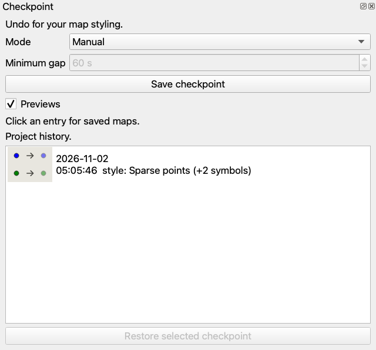
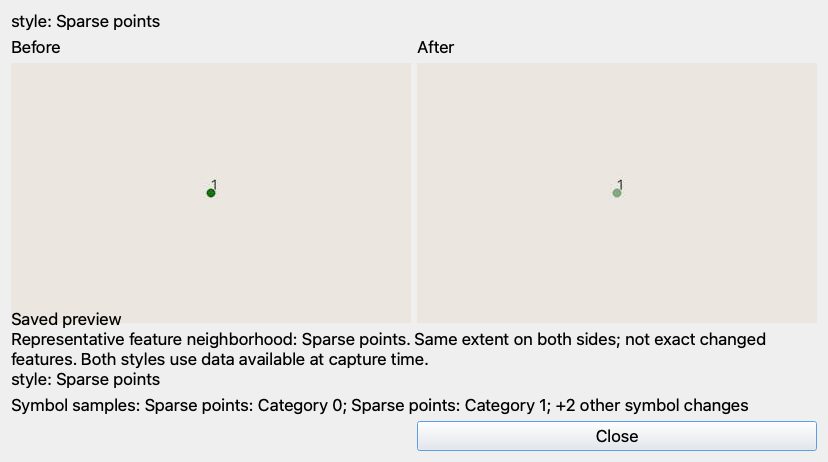

# Checkpoint

*Undo for your map styling.*

Checkpoint records how your QGIS map looks and restores earlier styling states
inside the open session. It captures layer order, groups, visibility, expansion,
full layer styles, filters, and map view. **It is not a backup tool** and does not
protect project files or source data against crashes or loss.

## Install

Download or build `checkpoint.zip`. In QGIS, open **Plugins → Manage and Install
Plugins → Install from ZIP**, select the archive, then enable **Checkpoint**.
The history dock appears on the right; its toolbar/menu action toggles the dock.
No extra Python packages are required.

Already using a development symlink? Restart QGIS to load updates from the linked
source. Do not install the ZIP over that symlink. Use a separate QGIS profile to
try the packaged build. See [installation and testing](docs/install.md).

## Use

1. Click **Save checkpoint** before editing to establish an initial state.
2. Change styling, filters, visibility, or layer/group order. In **Auto**, changes
   are captured after about two seconds of quiet and the chosen minimum gap.
   **Manual** disables automatic capture; Save checkpoint works in either mode.
3. Click a history row to inspect saved before/after previews. Click **Restore
   selected checkpoint** to apply it. Selection alone never restores anything.
4. Every Restore first pins a **before restore** checkpoint. Restore that entry to
   undo the operation. The result is a new unpinned entry; later history is retained.
5. Use **Pin / Unpin**, **Rename**, or **Delete** on a selected record. Deletion asks
   for confirmation, including for pinned records. Empty names restore the generated
   description.

Auto and Manual skip unchanged styling, including pan/zoom-only changes. Explicit
Restore events are the exception: both before and result records are saved even
when styling matches, preserving the exact map view.

## Settings

Use **Settings…** in the dock and select **Checkpoint** in standard QGIS Options:

| Option | Default | Behavior |
| --- | --- | --- |
| Save previews | On | Shared with the panel's Previews checkbox |
| Restore map view | On | Apply saved extent and scale during Restore |
| Unpinned history limit | 20 | Oldest unpinned entries are evicted; lowering applies immediately |
| Default automatic interval | 60 seconds | Minimum gap after changes, also applied to the current panel |

Pinned records never expire automatically. Before-restore records can accumulate;
unpin or delete them when no longer needed. Closing the dock does not disable Auto.

## Previews

Rows show small QGIS symbol samples **before → after**, with up to two changed
legend items and a count of the remainder. Dates appear once per day. Filter,
visibility, order, and label-only changes use descriptions and maps rather than
misleading identical symbol samples.

The comparison uses the same extent for both sides. It focuses on a representative
feature in an affected vector layer, making sparse points visible even in a large
project. Style/filter/visibility previews omit unrelated layers for speed. Order,
group, blending, and layer-opacity comparisons retain the full layer stack.
The note identifies the focus; widely separated changes may not all fit the view.
This is not detection of exactly which geographic features changed.

Images are captured once, using data available at checkpoint creation. Before
images survive eviction of the preceding entry. Opening an old entry never
rerenders against changed source data. Old checkpoints without previews stay
explicitly unavailable. Turning Previews off hides samples, cancels pending work,
and renders/stores no new images; existing images remain in history.

A two-second budget disables further rendering for a heavy project. Toggle
**Previews off/on** to reset that project's fuse, then create a new checkpoint.
Existing empty previews are not regenerated. Synchronous provider cloning and
feature access cannot be interrupted mid-call, so slow remote sources can still
delay preparation. WMS/XYZ previews may be partial or blank.

## Storage and limitations

- History lives under `QgsApplication.qgisSettingsDirPath()/checkpoint/`, keyed by
  the absolute project path. Nothing is stored inside or beside the `.qgz`.
- An unsaved project's history stays in memory until its first successful save.
  Closing it first loses that history. Renaming, moving, or Save As to a new path
  does not carry over an already-saved project's history.
- Deleted layers are skipped with a message. Layers added after the target snapshot
  keep their styling. A shared parent group's visibility still affects its children.
- Memory/scratch features and other source data are not versioned. Deleted layers
  cannot be recreated, including memory layers whose data disappeared with the session.
- If the safety checkpoint cannot be saved, Restore does not change the map.
  Provider errors can leave partial changes; the pinned safety record remains
  available. If saving the result fails, the message explains that the restored map
  is applied but not recorded. There is no automatic rollback after provider errors.
- CRS, project settings, custom layer order, Map Themes, and data versioning are
  outside this release. No CRS transformation is applied when restoring map view.
- No telemetry or cloud sync is implemented. QGIS providers may still access their
  configured remote sources when rendering previews. Local history contains style
  XML, filters, layer names, and optional images; treat it as project-related data.

## Release and validation

**0.1.0 is an experimental local release build. All seven implementation milestones
are complete.** It has not been published to GitHub Releases or the QGIS catalog.

Target: QGIS 3.28+ and 4.x, with Qt imports exclusively through `qgis.PyQt`.
Runtime validation: **QGIS 3.44.8 / Qt 5.15.18 / Python 3.12.11 on macOS**, using
an isolated offscreen profile. QGIS 3.28 and QGIS 4/Qt6 runtime testing remains
outstanding. Provider-specific behavior still needs testing with real projects.
The heavy-project fix has automated coverage but is not yet confirmed on the
user's affected project.

44 pure-Python tests cover hashing, descriptions, retention, atomic persistence,
previews, and packaging. Six real-QGIS scripts cover snapshots, watcher timing,
plugin lifecycle, Restore, previews, and settings/history actions. Release checks
also run these scripts against the extracted ZIP, not just the working tree.

A catalog search on 2026-11-02 found no indexed QGIS plugin named Checkpoint.
This is not a name reservation or approval; recheck the
[QGIS plugin catalog](https://plugins.qgis.org/plugins/) before publishing.

## Build and test

```sh
python3 -m venv .venv
.venv/bin/python -m pip install -r requirements-dev.txt
.venv/bin/python -m pytest -q
python3 scripts/package.py
```

The reproducible archive is `dist/checkpoint.zip`, with a SHA-256 sidecar. It has
one top-level `checkpoint/` directory containing runtime code, metadata, icon,
license, and documentation. Tests, caches, source data, and development tools are
excluded. The packager validates metadata, Python syntax, and ZIP integrity.

With a Python environment that can import QGIS:

```sh
python3 scripts/run_qgis_checks.py --package dist/checkpoint.zip
```

On this Mac use `/Applications/QGIS.app/Contents/MacOS/python` instead of `python3`.
The runner creates a disposable profile and never opens the user's live project.

[Architecture](docs/architecture.md) · [Preview implementation](docs/milestone-5.md) ·
[Changelog](CHANGELOG.md)

## Project and license

Author: Alen Alimzhanov, <mooly612@gmail.com>.
[Repository](https://github.com/Mooly612/checkpoint) ·
[Issues](https://github.com/Mooly612/checkpoint/issues).

Copyright (C) 2026 Alen Alimzhanov. Licensed under GNU GPL version 2 or later
(`GPL-2.0-or-later`). See [LICENSE](LICENSE).

## Product walkthrough

These are real offscreen Qt/QGIS screenshots from the preview tests, not mockups.
They show the milestone-5 preview UI; the current dock additionally has history
management and Settings buttons. Your QGIS theme may look different.





### What exactly does Restore selected checkpoint do?

Suppose you saved **A** with blue roads and visible buildings. You then changed
roads to red, hid buildings, and moved their group. Select **A** and press Restore:

1. The current red-road state is saved as pinned **before restore**.
2. Existing layers return to A's saved styles, filters, tree order, visibility,
   and expansion. Saved extent/scale return if Restore map view is enabled.
3. The actual result is appended as another history entry.

To undo this operation, select **before restore** and press Restore again.
This affects the saved state of all matching layers, not just the layer named in
one row's change description. It does not undo geometry/attribute edits, recreate
deleted layers, reopen a project file, or restore layouts/CRS. A map preview is
only an illustration; clicking it never applies the state.

### Concrete test examples

| Scenario | Expected result | Automated coverage |
| --- | --- | --- |
| Save twice without changing styling | One entry; duplicate message | Store and plugin tests |
| Pan across the map | No automatic checkpoint | Plugin tests |
| Restore while disk write fails | Map untouched if safety save fails | Restore tests |
| Delete a layer, restore old state | Deleted layer skipped with notice | Snapshot and Restore tests |
| Sparse point in a large project | Symbol sample and focused comparison | Preview tests |
| Renderer exceeds two seconds | Nonblocking cancellation and project fuse | Preview tests with stalled jobs |
| Cancel Delete | Record remains | Settings tests |
| Build twice | Identical ZIP bytes | Package tests |

See [the honest usability assessment](docs/usability.md) for alternatives and
current weaknesses. Automated checks do not establish usability for all projects.
